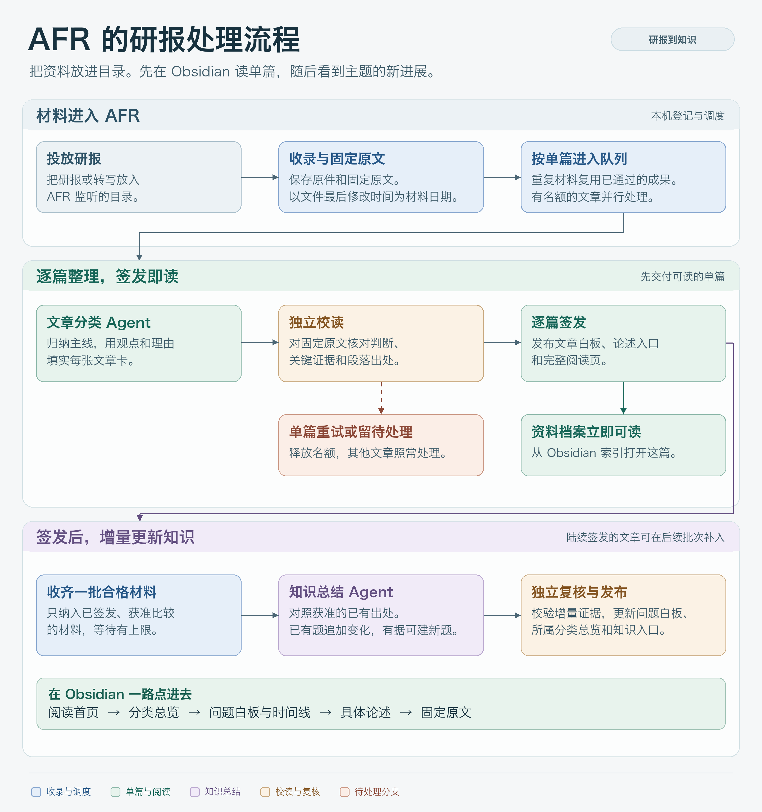
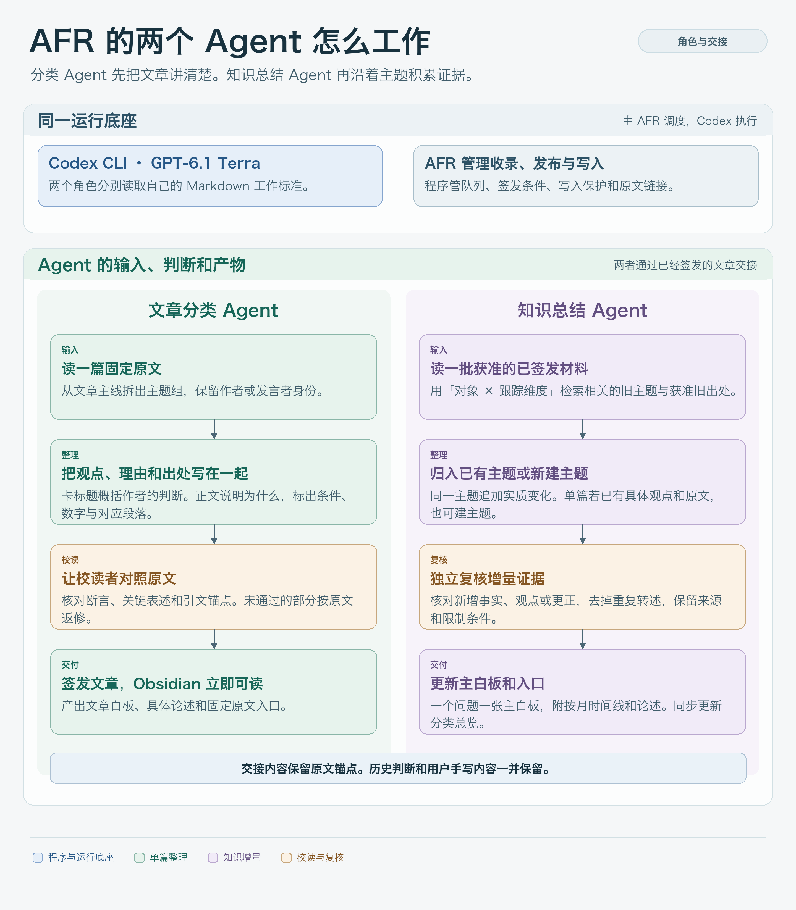
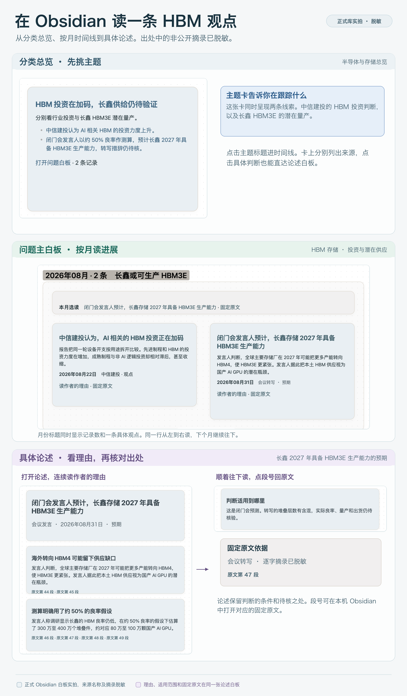

# Atom Flow Research · AFR

AFR 是一个在本机运行的研报整理工具。把文章放进投放文件夹，就能在 Obsidian 按主题阅读、点开作者的具体论述，并跳回固定原文。一篇文章整理完成就可以读。后续材料带来新证据时，AFR 更新对应的知识时间线。

[快速开始](#快速开始) · [处理流程](#从投放到研究) · [Agent 分工](#两个-agent-怎么工作) · [使用效果](#使用效果) · [文档](#文档)

## 从投放到研究

AFR 收录原件和可定位的固定原文，以文件最后修改时间作为材料日期。获准使用 Codex 的文章可并行处理。哪篇先通过校读，哪篇就先在 Obsidian 的「资料档案」可读。已签发且获准比较的材料随后按批更新知识总结，迟签材料在后续批次接上。



## 两个 Agent 怎么工作

- **文章分类 Agent** 读一篇固定原文，沿作者的主线组织白板。卡片标题写清观点，正文给出理由、适用条件和出处。独立校读通过后，文章白板与完整阅读即时发布。
- **知识总结 Agent** 读获准的已签发材料，按「对象 × 跟踪维度」找到对应主题。已有主题追加有证据的进展、分歧或更正。一篇材料能提出具体观点并提供可回查的出处时，也可以建立新主题。复核通过后，AFR 更新问题主白板、分类总览和知识总结入口。



## 使用效果

这组 Obsidian 实拍展示了 **HBM 存储 · 投资与潜在供应**。先从「半导体与存储总览」查看主题涉及的投资和供给判断，再进问题白板按月选读。放大以后，同一行从左到右读，下一行和下个月都在下方。

点开一条预期，可以继续看发言人的理由、良率假设和需要核验的地方。在本机白板上，原文段号可以点开。下图已脱敏会议来源名称和逐字摘录。



## 快速开始

本机需要 Python 3.11 或更高版本。用仓库自带的合成 Markdown 样例，可以先验证收录和原文检索。

```sh
demo=$(mktemp -d)
mkdir "$demo/inbox" "$demo/vault"
cp 'afr_agent/tests/fixtures/上架率小样.md' "$demo/inbox/"

python3 -m afr_agent scan --inbox "$demo/inbox" --vault "$demo/vault"
python3 -m afr_agent search --vault "$demo/vault" --scope source --query '机柜样本42'
```

搜索结果包含匹配段落、版本和 Obsidian 定位链接。把 `$demo/vault` 在 Obsidian 中打开即可查看收录成果。

处理 DOCX 或 PDF 时，按运行手册在本机安装解析依赖。生成经校读的白板需要已登录的 Codex CLI 和对具体材料版本的许可。AFR 当前配置两个角色使用 GPT-6.1 Terra。原件、知识库和许可文件保存在本机。[安装、监听、许可与 MCP](afr_agent/README.md)

## 文档

- [本机架构](docs/architecture/AFR-LOCAL-AGENT.md) · [知识总结设计](docs/research/AFR-KNOWLEDGE-SUMMARY-DESIGN.md)
- [文章白板标准](afr_agent/ARTICLE-BOARD-STANDARD.md) · [知识总结标准](afr_agent/KNOWLEDGE-SUMMARY-STANDARD.md)
- [Obsidian 白板与引用验收](scripts/check_vault_release.md)
