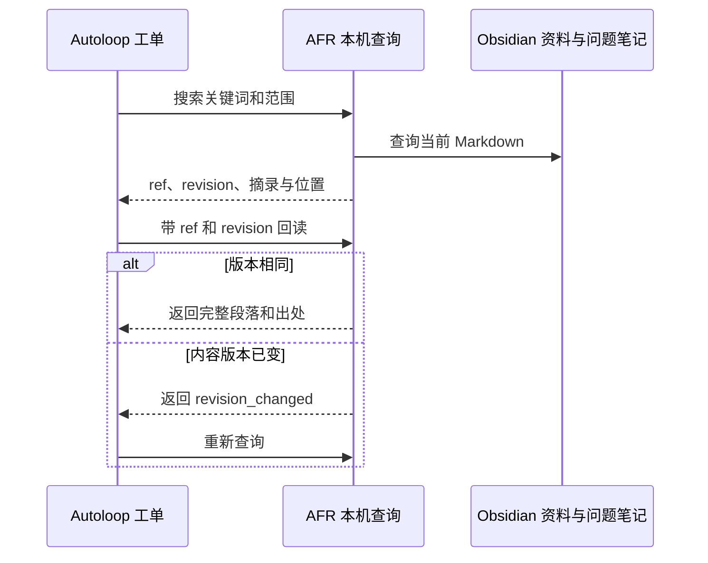

# AFR 本机 Agent 架构

AFR 保留研究资料的身份和证据，组织文件收录、签发与故障恢复。Codex harness 执行已获许可的结构化语义工作与会话工具调用。Obsidian 展示本机 Markdown 和 Canvas，Autoloop 用本机接口在工单里找资料并回查出处。

## 模块与职责

| 模块 | 持有的状态与行为 | 实现入口 |
| --- | --- | --- |
| 投放收录 | 检查文件写稳，按原件 SHA-256 去重，固定可读段落与解析缺口 | [intake.py](../../afr_agent/intake.py) |
| 本机工作流 | 保存各固定版本的处理状态、失败原因与重试，维护自动处理的历史版本范围 | [workflow.py](../../afr_agent/workflow.py) |
| 文章处理 | 归纳全文主题，经独立校读后逐篇签发。白板横向组织主题，阅读页按较大章节呈现原论述 | [semantic.py](../../afr_agent/semantic.py) · [presentation.py](../../afr_agent/presentation.py) |
| 知识总结 | 按批比较获准的已签发版本，经独立复核后追加带原文锚点的进展。发布问题主白板、时间线、详细论述和分类入口 | [knowledge.py](../../afr_agent/knowledge.py) · [knowledge_hierarchy.py](../../afr_agent/knowledge_hierarchy.py) |
| 旧研究问题兼容 | 读取旧候选、问题版本与关联的出处 | [reconcile.py](../../afr_agent/reconcile.py) · [questions.py](../../afr_agent/questions.py) |
| Codex 适配 | 调用已登录的 `codex exec`，经 JSON Schema 接收结构化结果，限定临时运行目录与工具 | [codex.py](../../afr_agent/codex.py) |
| 本机检索 | 解析当前可见的 Markdown，返回段落标识 `ref`、正文版本 `revision` 和可打开位置 | [library.py](../../afr_agent/library.py) · [命令入口](../../afr_agent/__main__.py) |
| Codex 研究会话 | 通过本机 MCP 读取已获许可的固定文章和问题。显式启用写入后，按版本保存或修订用户认可的讨论 | [mcp.py](../../afr_agent/mcp.py) · [MCP 配置](../../afr_agent/README.md#在-codex-读取和修改) |

## 证据与恢复

原件 SHA-256 标识输入文件。固定段落和白板话题分别提供对应的锚点，阅读页重新排版时继续使用同一话题定位。知识总结使用稳定的主题和记录 ID 连接原文、时间线和论述白板。搜索读取当前笔记，内容修改后用旧版本回读会报告变化。

工作流签发前验证阅读计划对应的固定证据。读入失败保留原件及到达的状态。重新启动监听可续跑，用户手工改过的已发表文件受到冲突保护。数据迁移使用本机备份与写前校验。参见 [AFR 本机运行手册](../../afr_agent/README.md) 和 [白板与引用验收](../../scripts/check_vault_release.md)。

## 权限边界

- 本机收录、检索和固定原文对照无需模型许可。原件正文进入自动研读前由 AFR 检查准入范围，Codex 调用前再读许可。历史版本仍可在本机检索与阅读。
- 两个角色由已有 Codex CLI 执行。文章角色组织单篇材料，知识总结角色按主题比较多篇材料。AFR 在独立校读或复核后验证返回结构及来源范围，再保存结果。
- MCP 只读工具按会话许可过滤来源。写入讨论使用显式配置与版本校验。Autoloop 保存工单、验收和引用，AFR 保存原件、正文、主题与研究问题。

[知识总结设计](../research/AFR-KNOWLEDGE-SUMMARY-DESIGN.md)
